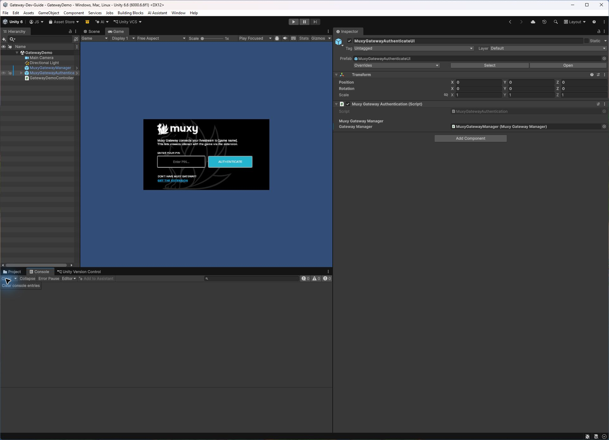
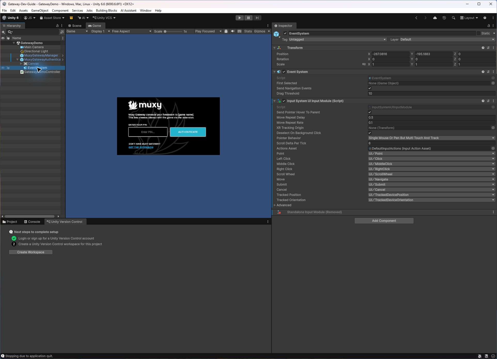
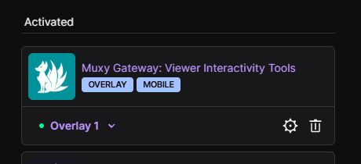
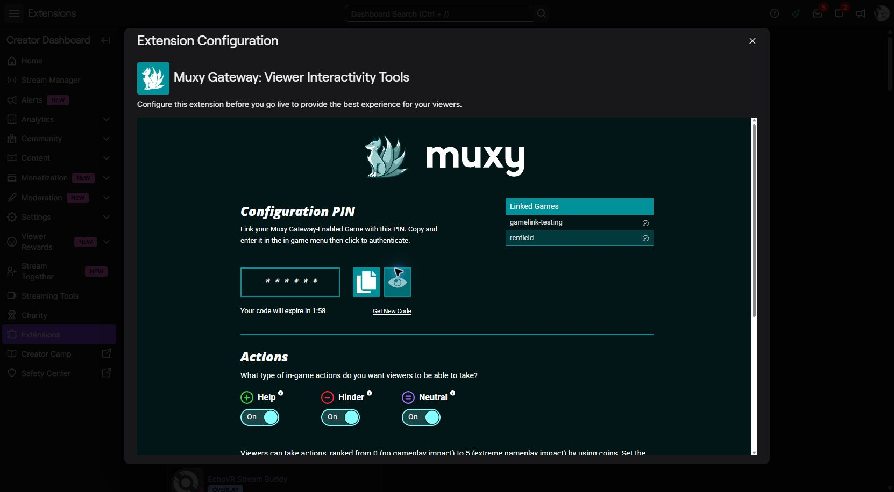
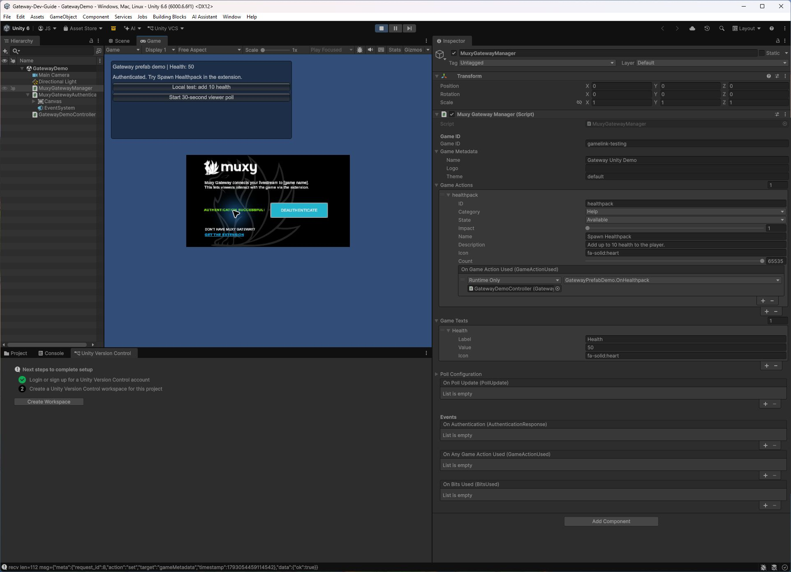
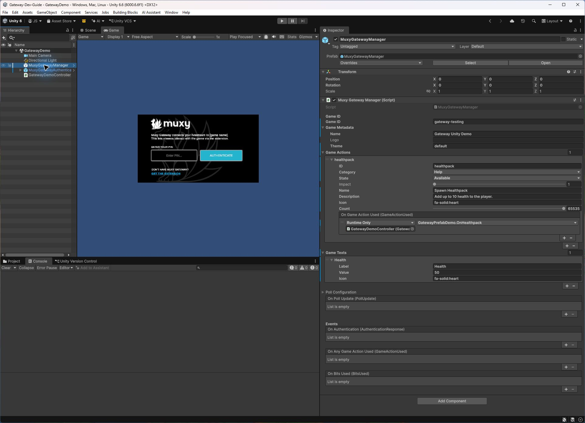
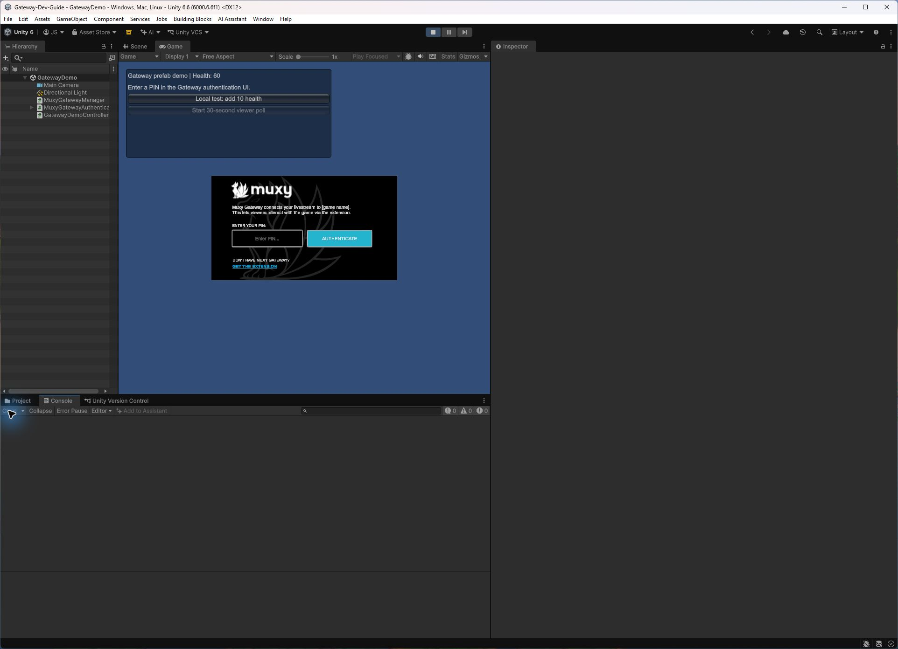
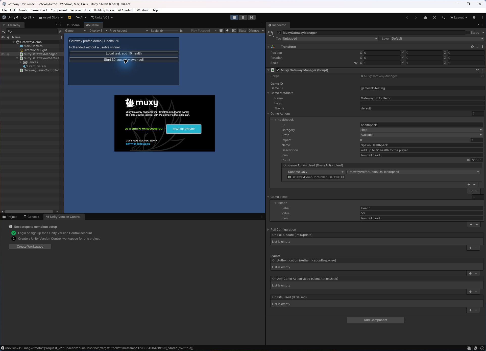

# Gateway Unity SDK Walkthrough

Take a new Unity project from package installation to a connected Twitch broadcaster channel. You will add a **Spawn Healthpack** action, publish a **Health** game text value, and run a 30-second viewer poll. The prefab supplies the authentication screen and SDK lifecycle; the [demo component](../assets/unity-gateway/GatewayPrefabDemo.cs) supplies test gameplay and a poll button.

This guide targets SDK **1.1.0-rc.1**. The screenshots show the Unity setup; numbered boxes mark the controls to use. The prefab connects to Gateway's production host. Use a Game ID linked to your broadcaster.

## Before you start

- Unity 2020.3 or newer and Git on your `PATH`. The illustrated setup was run in Unity 6000.6.6f1 on Windows.
- A Twitch broadcaster account that can install and activate the [Muxy Gateway extension](https://www.twitch.tv/ext/i575hs2x9lb3u8hqujtezit03w1740-1.0.0).
- A **Game ID linked to that broadcaster** in the extension's **Configure → Linked Games** view. Use the exact ID shown for your account.
- A separate viewer session, ideally while the channel is live, for the final action and vote checks.

If your own scripts use an assembly definition, add `Muxy.Gateway` to its Assembly Definition References. SDK types use `using MuxyGateway;`; prefab components such as `MuxyGatewayManager` are in the global namespace.

## 1. Install the SDK

1. In Unity, open **Window → Package Manager**.
2. Select **+ / Add → Install package from git URL** and paste:

    ```text
    https://github.com/muxy/gateway-unity.git#v1.1.0-rc.1
    ```

3. Wait for compilation. Confirm **Muxy Gateway 1.1.0-rc.1** appears and **Packages → Muxy Gateway → Prefabs** exists. Import **TMP Essential Resources** from **Window → TextMeshPro** if prompted.

You can also download the [release ZIP](https://github.com/muxy/gateway-unity/releases/tag/v1.1.0-rc.1), extract it outside `Assets`, and select **+ / Add → Add package from disk** with its `package.json`. Keep the extracted folder in place. [Unity's Git URL instructions](https://docs.unity3d.com/Manual/upm-ui-giturl.html) cover menu differences by Editor version.

## 2. Build the scene

1. Create and save a test scene, for example `GatewayDemo`.
2. Drag **`MuxyGatewayManager.prefab`** from the package's `Prefabs` folder into the Hierarchy. Keep one manager active. Set **Game ID** to the exact linked ID, **Game Metadata → Name** to `Gateway Unity Demo`, and **Theme** to `default`. Leave **Logo** empty for this first test.
3. Drag **`MuxyGatewayAuthenticateUI.prefab`** into the scene. In its `MuxyGatewayAuthentication` component, assign the scene's manager to **Gateway Manager**. Set this reference before entering Play mode; the UI subscribes when enabled.
4. Keep one **EventSystem**. The authentication prefab already contains one. Remove an extra scene EventSystem if Unity warns about duplicates.
5. In Unity 6 with the new Input System, select the authentication prefab's **EventSystem**. If **Standalone Input Module** warns that it will not work, select **Replace with InputSystemUIInputModule**. Make this change outside Play mode and save the scene. It made the PIN field clickable in this test.
6. On the manager, add **Game Texts** element 0: **Label** `Health`, **Value** `50`, **Icon** `fa-solid:heart`.
7. Save [GatewayPrefabDemo.cs](../assets/unity-gateway/GatewayPrefabDemo.cs) in your game's `Assets/Scripts` folder. Attach it to a new GameObject named `GatewayDemoController`, then assign its **Gateway Manager** field to the scene manager. Use **Assets → Refresh** if the component does not appear after copying it.
8. The demo uses `OnGUI` buttons. If your project uses only the new Input System, set **Edit → Project Settings → Player → Other Settings → Active Input Handling** to **Both**. Unity may require an Editor restart.

<figure class="gateway-shot" markdown="1">
<div class="gateway-shot__image" markdown="1">

[{ width="1924" height="1392" }](../assets/unity-gateway/02-scene-wiring.jpg)

<span class="gateway-shot__box" data-step="1" style="left: 3%; top: 11%; width: 10%; height: 8%;" aria-hidden="true"></span>
<span class="gateway-shot__box" data-step="2" style="left: 55%; top: 25%; width: 44%; height: 5%;" aria-hidden="true"></span>
</div>
<figcaption><span class="gateway-shot__key">1</span> Manager, authentication UI, and demo controller in the Hierarchy. <span class="gateway-shot__key">2</span> The authentication prefab's Gateway Manager reference.</figcaption>
</figure>

<figure class="gateway-shot" markdown="1">
<div class="gateway-shot__image" markdown="1">

[{ width="1924" height="1392" }](../assets/unity-gateway/02-input-module.png)

<span class="gateway-shot__box" data-step="1" style="left: 4%; top: 17%; width: 9%; height: 4%;" aria-hidden="true"></span>
<span class="gateway-shot__box" data-step="2" style="left: 55%; top: 27%; width: 44%; height: 31%;" aria-hidden="true"></span>
</div>
<figcaption><span class="gateway-shot__key">1</span> Select the authentication prefab's EventSystem. <span class="gateway-shot__key">2</span> Confirm Input System UI Input Module replaced the standalone module.</figcaption>
</figure>

**Checkpoint:** The manager, authentication UI, and demo controller have their references set; the scene is saved; the Console has no compilation errors.

## 3. Activate the extension and connect the broadcaster

1. In the Twitch Creator Dashboard, install Gateway under **Extensions** and activate it in a supported overlay or panel slot.
2. Open its **Configure** view. Under **Linked Games**, check the exact Game ID against the manager's **Game ID** field. Select **Get New Code** if the PIN has expired.
3. Enter the six-character PIN into the Unity authentication UI within five minutes and submit it. Keep PINs and returned tokens out of screenshots, source control, and logs.
4. In the Unity Game view, confirm the success state and the demo's **Authenticated** status. Stop and restart Play mode; a successful return-session authentication shows the stored refresh token was reused.

<figure class="gateway-shot" markdown="1">
<div class="gateway-shot__image" markdown="1">

[{ width="460" height="210" }](../assets/unity-gateway/03-extension-active.png)

<span class="gateway-shot__box" data-step="1" style="left: 6%; top: 64%; width: 87%; height: 24%;" aria-hidden="true"></span>
</div>
<figcaption><span class="gateway-shot__key">1</span> Gateway is active in Overlay 1, marked with a green status dot.</figcaption>
</figure>

<figure class="gateway-shot" markdown="1">
<div class="gateway-shot__image" markdown="1">

[{ width="1662" height="916" }](../assets/unity-gateway/03-extension-pin.png)

<span class="gateway-shot__box" data-step="1" style="left: 26%; top: 53%; width: 21%; height: 12%;" aria-hidden="true"></span>
<span class="gateway-shot__box" data-step="2" style="left: 56%; top: 40%; width: 18%; height: 11%;" aria-hidden="true"></span>
</div>
<figcaption><span class="gateway-shot__key">1</span> Masked configuration PIN and Get New Code link. <span class="gateway-shot__key">2</span> Linked Games; use the Game ID listed for your broadcaster.</figcaption>
</figure>

<figure class="gateway-shot" markdown="1">
<div class="gateway-shot__image" markdown="1">

[{ width="1924" height="1392" }](../assets/unity-gateway/04-authenticated.png)

<span class="gateway-shot__box" data-step="1" style="left: 14%; top: 10%; width: 23%; height: 5%;" aria-hidden="true"></span>
<span class="gateway-shot__box" data-step="2" style="left: 25%; top: 35%; width: 17%; height: 4%;" aria-hidden="true"></span>
</div>
<figcaption><span class="gateway-shot__key">1</span> Demo status says Authenticated. <span class="gateway-shot__key">2</span> The prefab confirms authentication succeeded.</figcaption>
</figure>

The authentication prefab stores its refresh token in `PlayerPrefs`. Use platform-secure storage before shipping. For sandbox connections, use the [code API](unity-gateway-installation.md).

## 4. Add and test a viewer action

Leave Play mode before editing the manager. Under **Game Actions**, add one element:

| Inspector field | Value |
| --- | --- |
| ID | `healthpack` |
| Name | `Spawn Healthpack` |
| Description | `Add up to 10 health to the player.` |
| Category | `Help` |
| State | `Available` |
| Impact | `1` |
| Icon | `fa-solid:heart` |
| Count | `65535` (`GameAction.InfiniteCount`) |

On the action's **On Game Action Used** event, select **+**, drag in `GatewayDemoController`, and choose **GatewayPrefabDemo → OnHealthpack** under **Dynamic GameActionUsed**. The dynamic binding passes the received transaction to the handler.

<figure class="gateway-shot" markdown="1">
<div class="gateway-shot__image" markdown="1">

[{ width="1924" height="1392" }](../assets/unity-gateway/05-action-inspector.jpg)

<span class="gateway-shot__box" data-step="1" style="left: 55%; top: 36%; width: 44%; height: 14%;" aria-hidden="true"></span>
<span class="gateway-shot__box" data-step="2" style="left: 58%; top: 50%; width: 41%; height: 6%;" aria-hidden="true"></span>
<span class="gateway-shot__box" data-step="3" style="left: 55%; top: 60%; width: 44%; height: 8%;" aria-hidden="true"></span>
</div>
<figcaption><span class="gateway-shot__key">1</span> Healthpack action fields. <span class="gateway-shot__key">2</span> Dynamic OnHealthpack event binding. <span class="gateway-shot__key">3</span> Health game text.</figcaption>
</figure>

First use **Local test: add 10 health** in the Game view. Health should change from **50** to **60**. This checks the demo behavior and UI input only. Restart Play mode to reset health to 50.

<figure class="gateway-shot" markdown="1">
<div class="gateway-shot__image" markdown="1">

[{ width="1924" height="1392" }](../assets/unity-gateway/04-local-test.jpg)

<span class="gateway-shot__box" data-step="1" style="left: 14%; top: 10%; width: 23%; height: 8%;" aria-hidden="true"></span>
</div>
<figcaption><span class="gateway-shot__key">1</span> Health is 60 after selecting Local test: add 10 health.</figcaption>
</figure>

Then authenticate, open the extension as a viewer while the channel is live, and select **Spawn Healthpack**. Unity should report **Viewer action received: healthpack** and Health should become **60**. The demo calls `AcceptGameAction` after applying the effect; deduplicate transaction IDs and use `RefundGameAction` if an effect cannot be applied.

## 5. Publish game text and run a poll

The demo updates **Health** game text after authentication and health changes. `SetGameTextAt` publishes the updated list. Call `SubmitGameTexts` when adding or clearing entries.

While authenticated, select **Start 30-second viewer poll**. A final callback arrives after 30 seconds. With no votes, the demo reports **Poll ended without a usable winner**.

<figure class="gateway-shot" markdown="1">
<div class="gateway-shot__image" markdown="1">

[{ width="1924" height="1392" }](../assets/unity-gateway/07-poll-no-votes.png)

<span class="gateway-shot__box" data-step="1" style="left: 14%; top: 10%; width: 23%; height: 5%;" aria-hidden="true"></span>
</div>
<figcaption><span class="gateway-shot__key">1</span> The demo reports that the poll ended without a usable winner after no viewer votes.</figcaption>
</figure>

To verify voting, have a viewer submit an option through the live extension and check the final winner in Unity. If you add `MuxyGatewayPolling.prefab`, assign its **Gateway Manager** and forward the poll callback to its `OnPollUpdate` event. See [polls and game text](unity-gateway-polls-game-text.md).

## 6. Test and troubleshoot

| Check | Expected result | If it fails |
| --- | --- | --- |
| Package import | Version `1.1.0-rc.1` and prefabs appear; no C# errors | Check Git on `PATH` or the release ZIP's `package.json`. |
| PIN field | Click and type in Play mode | Keep one EventSystem; replace Standalone Input Module with Input System UI Input Module outside Play mode. |
| Authentication | Success UI and authenticated demo status | Use a fresh PIN; match **Game ID** to **Linked Games** exactly; check that Gateway is active. |
| Return session | Restarting Play mode authenticates again | Check that initial authentication succeeded and local `PlayerPrefs` was retained. |
| Local health button | Health changes 50 → 60 | Set **Active Input Handling** to **Both** for the demo's `OnGUI` buttons; assign the manager reference. |
| Viewer action | Health changes after a viewer selects the action | Confirm the channel is live, extension visible, and **Dynamic GameActionUsed** wired to `OnHealthpack`. |
| Poll | Final result arrives after 30 seconds | Confirm authentication, select the poll button once, and wait for the final update. No votes is a valid outcome. |

The screenshots capture setup and local checks. Verify a viewer action and submitted vote with your own live channel. Run the [QA checklist](unity-gateway-qa.md) on each player target you plan to ship.

Next, review the [custom-code installation](unity-gateway-installation.md) if you need to own the SDK lifecycle instead of using the prefab.
